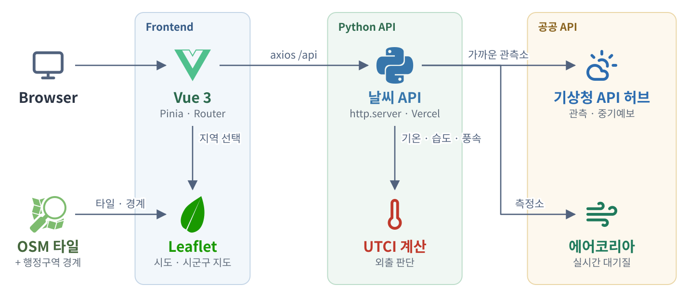

# Vue_Practice_Weather

Vue 학습 과제를 브랜치별로 관리하는 저장소입니다. `main`에는 이 안내만 있고 앱 코드는 과제 브랜치에 있습니다.

최종 앱은 **Outcast**로, 기상청 날씨·중기예보와 AirKorea 대기질을 보여 줍니다. [최종 브랜치의 기능·실행 안내](https://github.com/cres17/skala-vue-weather/blob/9-weather-final/README.md)를 확인하세요.

## 아키텍처

<picture>
  <source media="(prefers-color-scheme: dark)" srcset="docs/assets/readme/architecture-dark.svg">
  
</picture>

최종 앱 코드는 9-weather-final 브랜치에 있습니다. main은 과제 브랜치 목차이며, 아래 그림은 최종 앱의 구조입니다. Vue와 Leaflet이 화면·지역 선택을 담당하고 Python 서버가 기상청·AirKorea 응답과 UTCI 계산을 조합합니다. 날씨와 대기질은 등록된 관측소 목록을 기준으로 조회합니다.

| 구성 | 역할 |
|---|---|
| 화면 | Vue 3·Vite와 Leaflet 지도, 현재 관측·중기예보 카드 |
| 서버 | 기상청·AirKorea 키를 서버에서 읽고 API 응답 조합 |
| 계산 | UTCI 체감온도와 대기질·강수 기반 외출 판단 |

## 기술 스택

<picture>
  <source media="(prefers-color-scheme: dark)" srcset="docs/assets/readme/tech-stack-dark.svg">
  
</picture>

| 영역 | 사용 기술 | 역할 |
|---|---|---|
| 화면 | Vue 3, JavaScript, Vite | 도시 선택과 날씨·대기질 화면 |
| 지도 | Leaflet | 행정구역 레이어와 지역 선택 |
| 서버 | Python 3, utci==1.0.0 | 외부 API 조합과 체감온도 계산 |
| 데이터 | 기상청 API 허브, AirKorea | 현재 관측·중기예보·대기질 |
| 실행 | npm, concurrently | 개발 시 Vite와 Python 서버 동시 실행 |

## 브랜치별 과제

| 번호 | 과제 | 브랜치 | 상태 |
| --- | --- | --- | --- |
| 1 | Weather Mockup | `1-weather-mockup` | 완료 |
| 2 | Weather Composition | `2-weather-composition` | 완료 |
| 3 | Weather Component | `3-weather-component` | 완료 |
| 4 | Weather Router | `4-weather-router` | 완료 |
| 5 | Weather Store | `5-weather-store` | 완료 |
| 6 | Weather Axios | `6-weather-axios` | 완료 |
| 7 | Weather UI Library | `7-weather-ui-library` | 완료 |
| 8 | Weather Deployment | `8-weather-deployment` | 완료 |
| 9 | final_project | `9-weather-final` | 완료 |

## 최종 앱 실행

Node.js `^20.19.0 || >=22.12.0`과 npm, Python 3가 필요합니다.

```bash
git clone --branch 9-weather-final https://github.com/cres17/skala-vue-weather.git
cd skala-vue-weather
npm ci
python3 -m venv .venv
source .venv/bin/activate
python -m pip install -r requirements.txt
cp .env.example .env
```

`.env`에 `KMA_API_KEY`와 `AIR_KOREA_API_KEY`를 입력한 뒤 같은 터미널에서 `npm run dev`를 실행합니다. Python API 서버와 Vite가 함께 실행되며 접속 주소는 Vite 출력에서 확인합니다.

위 설치 명령은 macOS·Linux 기준입니다. 다른 과제 브랜치는 구성이 다를 수 있으므로 해당 브랜치의 README와 package.json을 따릅니다.
